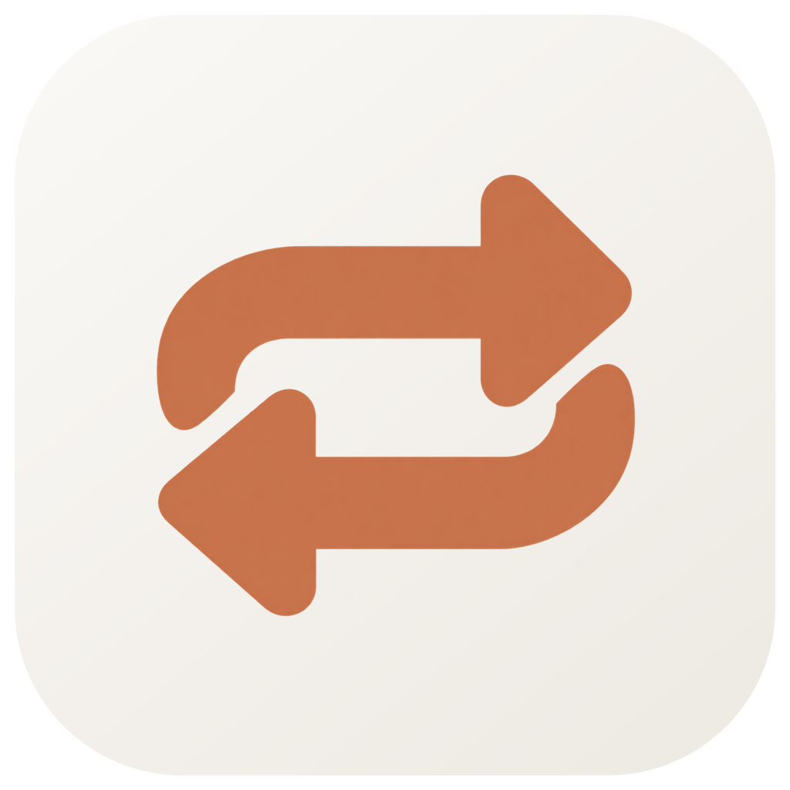
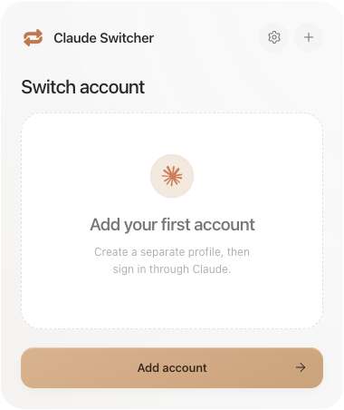
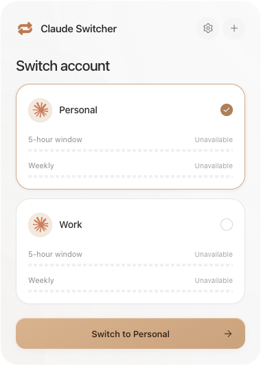

<p align="center"></p>
<h1 align="center">Claude Switcher</h1>
<p align="center">Your Claude accounts, a click apart.</p>
<p align="center">
  <a href="https://github.com/bazarkua/claude-switcher/actions/workflows/ci.yml"></a>
  
  <a href="LICENSE"></a>
</p>

A small, local tray app for separate Claude Desktop profiles, with a compact neutral interface and careful Claude Code history synchronization. No backend, telemetry, or credential juggling.

<p align="center"> &nbsp; </p>
<p align="center"><sub>Actual application screenshots. The pictured profiles are unauthenticated test profiles.</sub></p>

**Early release:** isolated profile launch was verified against Claude Desktop 4.29.0 on Apple Silicon. Two-account sign-in and authenticated continuation still require interactive testing. Windows and Intel runtime compatibility are not established by the Mac test. This app is unofficial and is not affiliated with or endorsed by Anthropic.

## Run locally

Install [Node.js](https://nodejs.org/) 22.12 or newer and the official [Claude Desktop](https://claude.ai/download). macOS and Windows are supported by the codebase.

```sh
git clone https://github.com/bazarkua/claude-switcher.git
cd claude-switcher
npm ci
npm run dev
```

The app opens the approved compact tray panel, with neutral light and dark themes and terracotta accents. Settings contains General, Usage, and Profiles tabs. On macOS, its Dock icon is hidden. Click the menu-bar or system-tray icon to reopen it. Click outside or press Escape to dismiss it. Right-click the icon to quit.

## Add and switch accounts

1. Choose **Add your first account**, name it, and sign in through the Claude window that opens.
2. Create a Code conversation in that isolated profile so Claude creates its account and organization session store.
3. From the account's `…` menu, choose **Check local profile**. A detected local account is not proof that its authentication is still valid.
4. Repeat for the second account. Select it and choose **Switch to …**.
5. Stop all Claude requests before accepting the graceful-close prompt. Every Claude window is closed before session metadata is synchronized.

Your original Claude profile remains separate. Browser OAuth callbacks are controlled by Claude and the operating system and may return to the default Claude window. This utility does not replace the `claude://` handler or forward authentication URLs. Verify the account inside each isolated Claude window. If the callback cannot complete there, that Claude version's multi-profile authentication remains unsupported by this app.

Usage and plan values are shown only when a reliable source exists. Currently the interface displays **Usage unavailable** and never labels a profile as live-authenticated.

## What happens to Code history

Claude 4.29.0 keeps per-account session records at:

```text
<Claude profile>/claude-code-sessions/<account UUID>/<org UUID>/local_<UUID>.json
```

Code transcripts live separately under `~/.claude/projects/` (or `%USERPROFILE%\.claude\projects\`). Claude Switcher validates local JSONL references, chooses the newest recognized metadata for each session ID, and writes allowed reference fields into the selected managed account's existing store. Original profiles are read-only sources. Original transcripts are never edited, truncated, or deleted.

Each change has an atomic write, a local backup, and a write-ahead recovery journal. Newer target records, malformed records, missing transcripts, and target deletion markers are preserved or skipped. The app does not guess between multiple account/org stores. You can disable history synchronization in Preferences and still launch profiles.

**Local history is not verified continuation.** A sidebar entry does not prove that another subscription can resume its context. Chat and Cowork history are outside the cross-account guarantee. No summary-based replacement conversation is presented as the original thread.

## Commands

| Command                 | Purpose                                                                 |
| ----------------------- | ----------------------------------------------------------------------- |
| `npm run dev`           | Launch with renderer hot reload                                         |
| `npm start`             | Launch the last production build                                        |
| `npm run typecheck`     | Check strict TypeScript                                                 |
| `npm run lint`          | Run ESLint                                                              |
| `npm run format:check`  | Check formatting                                                        |
| `npm test`              | Run isolated filesystem and switching tests                             |
| `npm run test:e2e`      | Build and test the actual Electron UI                                   |
| `npm run verify:claude` | macOS: launch and gracefully close a disposable isolated Claude profile |
| `npm run build`         | Build main, preload, and renderer                                       |
| `npm run dist`          | Package for the current platform                                        |
| `npm run dist:mac`      | Build Apple Silicon and Intel DMGs                                      |
| `npm run dist:win`      | Build a Windows x64 NSIS installer                                      |
| `npm run icons`         | Regenerate platform icons from the generated logo                       |

Packages appear in `release/`. To build unsigned development DMGs on macOS:

```sh
CSC_IDENTITY_AUTO_DISCOVERY=false npm run dist:mac
```

Unsigned builds may require an explicit Open action in macOS Privacy & Security. Public distribution needs your own signing identities. See [distribution notes](docs/DISTRIBUTION.md).

## Troubleshooting

- **Claude not found:** open Preferences and choose **Locate Claude Desktop**. Select `Claude.app` on macOS or `Claude.exe` on Windows.
- **Sign-in unverified:** sign in inside the isolated window and create one Code conversation. Check the local profile again. Expired authentication is handled by Claude's sign-in UI.
- **History unavailable:** the account may not have a session store, may have multiple organization stores, or may use an unrecognized schema. Profile launching still works. Check Diagnostics.
- **Claude is still running:** finish or stop requests, then quit Claude manually. The app never escalates to a force quit.
- **Interrupted synchronization:** quit every Claude window, then use **Restore interrupted sync** in Preferences. Recovery refuses to overwrite files changed after the interruption. **Open session backups** provides access to the originals.
- **Launch at login:** install a packaged build first. This setting is unavailable during development.

App state and backups live at `~/Library/Application Support/Claude Switcher/managed` on macOS and `%APPDATA%\Claude Switcher\managed` on Windows. Removing an account from the list retains its isolated directory. Backups are not automatically pruned.

See [validation results and the two-account checklist](docs/VALIDATION.md), [architecture](docs/ARCHITECTURE.md), and [research](docs/RESEARCH.md).

## License

[MIT](LICENSE). Contributions should follow [CONTRIBUTING.md](CONTRIBUTING.md). Report security concerns privately as described in [SECURITY.md](SECURITY.md).
